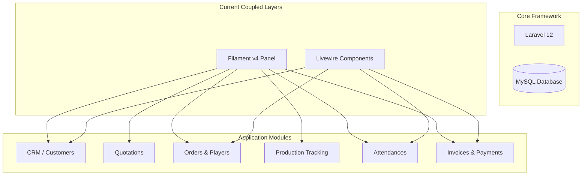

# Project Audit: Laravel ERP Refactoring (Filament & Livewire Removal)

## 1. Temuan (Findings)

### 1.1 Tech Stack & Folder Structure
*   **Laravel Version:** Laravel 12 (latest version).
*   **PHP Version Requirement:** `composer.json` restricts PHP to `^8.2`, but the target environment uses PHP 8.4+.
*   **Database:** MySQL 8 with 23 migrations, fully standard naming conventions (`snake_case` tables/columns, BIGINT UNSIGNED primary keys, proper indexes, and foreign keys).
*   **Frontend Assets:** TailwindCSS v4 configured with Vite (`resources/css/app.css` uses `@import 'tailwindcss'`).
*   **Admin Panel:** Currently managed by **Filament v4** using `app/Providers/Filament/AdminPanelProvider.php`, which auto-discovers resources under `app/Filament/Resources`.
*   **Livewire Integration:** 4 Livewire components inside `app/Livewire/` with views in `resources/views/livewire/` for the Customer Portal, Employee Attendance, Order Tracker, and Portal Login.

### 1.2 Resource Structuring
The Filament resources are structured in an decoupled manner:
Each resource folder (e.g., `app/Filament/Resources/Orders`) contains:
*   `OrderResource.php` - Configures the model and routes.
*   `Pages/` - Create, Edit, List pages.
*   `Schemas/OrderForm.php` - Contains form schemas using Filament form components.
*   `Tables/OrdersTable.php` - Contains table configuration with columns, filters, and actions.
This modularity is highly beneficial for refactoring as the business field schemas are already separated from the main resource class.

### 1.3 Missing MVC Abstractions
*   **Controllers:** Only the base [Controller.php](file:///d:/xampp/htdocs/eighteen-custom-apparel/app/Http/Controllers/Controller.php) exists. No resource controllers are defined.
*   **Middleware:** No custom middleware for role-based access control (RBAC).
*   **Policies:** No Laravel policies defined to restrict model access. All role validation is currently handled implicitly by Filament or not implemented.
*   **Form Validation:** No custom FormRequests exist; validation is written inline inside Livewire components or handled via Filament rules.

### 1.4 Code Bugs / Architecture Violations
*   **PSR-4 Violation:** The helper class `UserSeederHelper` is declared at the bottom of [QuotationService.php](file:///d:/xampp/htdocs/eighteen-custom-apparel/app/Services/QuotationService.php) (lines 140-145). This causes dynamic class resolution failure when other services (like `OrderService`) invoke `UserSeederHelper::getFirstAdminId()` before `QuotationService` is loaded.

---

## 2. Risiko (Risks)

*   **R1: Role-Based Access Control (RBAC) Security Gaps**
    *   *Deskripsi:* Removing Filament Shield and Filament's built-in auth means we must manually build secure middlewares and policies for roles (`Super Admin`, `Owner`, `Sales`, `Production`, `HRD`, `Finance`, `Customer`).
    *   *Mitigasi:* Implement Laravel Policies for all primary models and enforce them in controllers and Blade templates.
*   **R2: Form State Complexity & Interactivity Loss**
    *   *Deskripsi:* Filament and Livewire provide real-time form calculation (e.g., updating subtotals and grand totals in `QuotationForm` when items are modified) out-of-the-box. Removing them requires duplicating this logic using Alpine.js or native JS.
    *   *Mitigasi:* Standardize Alpine.js templates for dynamic forms (repeaters) to calculate subtotals, taxes, discounts, and totals dynamically on the client side.
*   **R3: File Uploads & Security**
    *   *Deskripsi:* Design files and payment proofs are uploaded. We must ensure secure upload handling without Livewire's temporary uploaded files handler.
    *   *Mitigasi:* Create dedicated secure file upload handling in controllers.

---

## 3. Dependency Map

Below is the dependency map showing the current framework coupling:

---

## 4. Prioritas Refactor (Refactor Priority)

The refactoring will be executed in a bottom-up sequence (least dependent to most dependent) to ensure maximum application stability:

| Priority | Module | Reason |
|---|---|---|
| **1. Foundation** | Auth & Layouts | Establish the admin dashboard layout, sidebar navigation, and custom RBAC middleware first. |
| **2. Category & Catalog** | Product Categories & Products | Required by Quotations and Orders. Minimal complexity. |
| **3. Customer Relations** | Customers & CRM | Required by Quotations, Orders, and Invoices. |
| **4. HR & Staffing** | Employees & Attendance | HR tracking. Employee Attendance portal must be migrated from Livewire to standard Controller/AlpineJS. |
| **5. Sales Flow** | Quotations | Quotations feed into Orders. |
| **6. Core Order Management** | Orders & Player List | Heart of the system. Involves design files and player list. |
| **7. Production Pipeline** | Production Stages & Logs | Depends on Orders. Handles status transitions. |
| **8. Financials** | Invoices & Payments | Depends on Orders. Payment proof upload workflow must be migrated. |
| **9. Reporting & UI Polish** | Dashboards & Reports | Aggregates data from all modules. |
